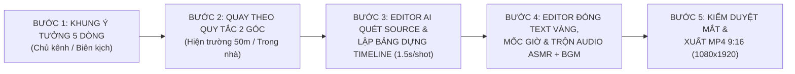

# GIẢI PHÁP QUY TRÌNH ĐỒNG BỘ 3 KHÂU (TRỌNG TÂM EDITOR) & PHẢN BIỆN HỆ THỐNG
**Phong cách Edit**: **`Daily Routine / Family Lifestyle Vlog kết hợp KOC Affiliate Seeding ẩn`**

---

## I. TƯ DUY PHẢN BIỆN (`CRITICAL ANALYSIS`): TẠI SAO NHIỀU ĐỘI LÀM VLOG GIA ĐÌNH THẤT BẠI KHI ĐƯA VÀO EDIT?

Trước khi xây quy trình, chúng ta cần phản biện thẳng thắn **4 điểm đứt gãy thực tế** thường xảy ra giữa Người quay (Chủ kênh/Nhân sự hiện trường) và Người dựng (Editor):

### 1. Phản biện #1: Sự khác biệt bản chất giữa "Vlog Đời Thường" và "Video Tài Liệu"
- Ở ngách **Tài liệu Lịch sử**: Có Kịch bản chữ + File thu âm (Voice) trước $\rightarrow$ Editor đi tìm ảnh/video minh họa khớp theo từng giây âm thanh.
- Ở ngách **`Daily Routine / Family Lifestyle Vlog`**: **KHÔNG CÓ GIỌNG ĐỌC THUYẾT MINH** (`[ĐÃ XÁC MINH]` từ video mẫu: `VAD Speech = 0`). Mạch truyện được dẫn dắt 100% bằng **Chuỗi hành động thực tế (70 cú cắt / 116 giây)** kết hợp với **Hệ thống Chữ nhảy trên màn hình (On-Screen Text) + Cột mốc giờ (`5:30`, `6:00`...)**.
- **Hệ quả nếu không đồng bộ**: Nếu người quay chỉ bấm máy quay 1 góc cố định dài 2–3 phút cảnh nấu ăn mà không có góc cận (Close-up) bấm nút, thái thịt, múc canh, hoặc thiếu cảnh phản ứng của cháu ngoại/mẹ vợ, thì **Editor giỏi đến mấy cũng không thể cắt ra nhịp `1.3s – 1.7s/shot`** (vì cắt trên cùng 1 góc máy sẽ bị giật hình - Jump Cut thô kệch).

### 2. Phản biện #2: Rủi ro "Quảng cáo lộ liễu" làm sập tương tác
- Khán giả xem kênh vì thích hình tượng **Người đàn ông 50 tuổi thương vợ, chăm 2 cháu ngoại, hiếu thảo với mẹ vợ bị ngã**, chứ không vào để xem quảng cáo gia dụng.
- Trong video mẫu (`snaptik_7668508308268961032`), sản phẩm không bao giờ xuất hiện ở 15 giây đầu. Nó luôn xuất hiện ở **giữa video (`mốc 5:30` và `5:45`)** và luôn đi kèm **1 lý do tình cảm gia đình hợp lý** (*"Cả nhà đang cúm nên pha trà tía tô"*, *"Bé Bin ốm quấy đêm nên để con dâu ngủ thêm"*).
- **Vai trò quyết định của Editor**: Editor chính là người **viết và đặt nhịp Text trên màn hình** để biến cảnh quay sản phẩm thành cảnh chăm sóc gia đình!

### 3. Phản biện #3: Bẫy "Quá tải bối cảnh" (Có tới 6 người + Chợ 50m + Mẹ vợ 50m)
- Gia đình có chất liệu cực giàu (Vợ, Con gái 2, Con rể, 2 Cháu ngoại, Mẹ vợ cách 50m, Chợ cách 50m).
- **Phản biện**: Nếu 1 video `1 phút 45 giây` mà nhồi nhét cả 8 yếu tố này vào thì video sẽ bị loãng, không có điểm nhấn cảm xúc.
- **Giải pháp**: Mỗi video chỉ chọn **1 Trục Câu Chuyện Chính (1 Nhân vật đối trọng + 1 Hành trình giờ giấc + Tối đa 1–2 Sản phẩm)**. Ví dụ:
  - *Tập 1*: Trục `[Ông ngoại 50 tuổi + Đi chợ 50m + Nấu canh hầm mang sang cho Mẹ vợ bị ngã nhà vệ sinh]`.
  - *Tập 2*: Trục `[Bố vợ 50 tuổi + Sống chung với Con rể + 5h30 dậy chuẩn bị bữa sáng cho vợ chồng con gái đi làm & chăm 2 cháu ngoại]`.

### 4. Phản biện #4: Gánh nặng cho Chủ kênh 50 tuổi nếu bắt làm Input phức tạp
- Nếu bắt người quay phải đổi tên hàng chục file video, ghi chép timecode từng giây rồi mới gửi cho Editor $\rightarrow$ Rất dễ nản, không duy trì được lịch ra video hàng ngày (Daily Routine).
- **Giải pháp**: Quy trình phải thiết kế sao cho **Người quay cung cấp Input tối giản nhất (thảy toàn bộ clip thô trong buổi sáng vào 1 thư mục + 5 dòng ghi chú cốt truyện)**, còn **Hệ thống Editor (AI + Công cụ tự động)** sẽ đảm nhận việc quét toàn bộ video thô, lọc khoảnh khắc đắt giá, cắt nhịp `1.5s`, đóng mốc giờ và lên chữ!

---

## II. ĐỀ XUẤT GIẢI PHÁP: QUY TRÌNH 5 BƯỚC ĐỒNG BỘ (LẤY EDITOR LÀM TRUNG TÂM)

### Bước 1: Định hình Khung Kịch Bản Ngắn (Pre-Shoot Brief — Chỉ 5 gạch đầu dòng)
Trước khi bấm máy buổi sáng, xác định nhanh:
1. **Câu Hook 2 giây đầu**: Đánh vào mối quan hệ nào? *(VD: "50 tuổi làm bố vợ / Sống chung với con rể / 5h30 bố vợ đã đi chợ, còn con rể thì...")*.
2. **Hành trình Giờ giấc (Time-Stamp Spine)**: Từ mấy giờ đến mấy giờ? *(VD: `5:30` Đi chợ cách 50m $\rightarrow$ `6:00` Sơ chế & Hầm xương $\rightarrow$ `6:30` Mang sang cho mẹ vợ cách 50m $\rightarrow$ `7:00` Về cho 2 cháu ngoại ăn)*.
3. **Điểm chạm Cảm xúc (Wholesome Twist)**: Giải thích lý do nhân văn ở giữa video.
4. **Sản phẩm Seeding (1–2 món)**: Gắn vào thao tác nào?

### Bước 2: Quay Thực Tế theo Quy tắc "Đồng bộ cho Editor"
- Quay dọc `9:16` (`1080x1920`, `30fps` hoặc `60fps`).
- Mỗi hành động chỉ cần quay ngắn `4 – 8 giây`, luôn nhớ cặp đôi: **1 cảnh Góc rộng thấy người (3–5s)** + **1 cảnh Góc cận thấy tay/sản phẩm/món ăn (3–5s)** để Editor có chất liệu cắt nối nhịp `1.5s`.

### Bước 3: Editor AI Giải phẫu Source Quay (Ingest & Smart Cut Selection)
- Editor nhận thư mục chứa `20 – 50 file video thô (.mp4/.mov)` quay từ điện thoại.
- **Tự động trích xuất Frame đại diện & Phân tích chuyển động/âm thanh của từng file thô**:
  - Loại bỏ các đoạn rung lắc đầu/cuối mỗi lần bấm máy (chừa đúng `1.2s – 2.0s` có hành động đắt giá nhất — *Cutting on Action*).
  - Sắp xếp các đoạn cắt theo đúng **Trục Thời Gian (`5:30` $\rightarrow$ `7:30`)** và luân phiên **Góc Toàn $\leftrightarrow$ Góc Cận**.
  - Trích xuất 3 khoảnh khắc đắt giá nhất đưa lên `0.0s – 2.2s` đầu làm **Flash-forward Hook**.

### Bước 4: Editor Lên Nhịp Chữ (On-Screen Text), Mốc Giờ & Thiết kế Âm thanh
- Áp dụng đúng chuẩn Typography của video mẫu:
  - Đóng **Cột mốc giờ màu Vàng cỡ lớn** (`5:30`, `5:45`, `6:15`, `7:00`...) ở đỉnh vùng `1/3 trên`.
  - Viết các câu dẫn chuyện ngắn (`3–8 chữ/dòng`, màu Vàng `#FFE600` viền Đen dày) khớp theo từng cú cắt `1.5s`.
  - Giữ lại âm thanh ASMR tự nhiên của cảnh quay (tiếng xào nấu, tiếng nước chảy, tiếng nói chuyện ngắn của ông cháu/mẹ vợ ở mức `-15dB`) và phủ nhạc nền (BGM) ấm áp xuyên suốt.

### Bước 5: Đạo diễn Kiểm duyệt Bằng Mắt & Xuất Video Hoàn chỉnh (`.mp4`)
- Trích xuất Contact Sheet của bản dựng để kiểm tra: Chữ có bị lẹm vào mặt nhân vật không? Nhịp cắt có đoạn nào bị lê thê quá `3 giây` không? Sản phẩm lên hình đã đủ nét và tự nhiên chưa?
- Xuất file `.mp4` chuẩn `1080x1920` (`9:16`, `30fps`) sẵn sàng đăng TikTok/Reels.

---

## III. HỢP ĐỒNG GIAO TIẾP: NGƯỜI DÙNG CẦN CUNG CẤP GÌ (INPUT) & ĐẦU RA LÀ GÌ (OUTPUT)?

Để bắt đầu bất kỳ 1 video nào trong thư mục [`Lifestyle Vlog`](../../), quy chuẩn Đầu vào – Đầu ra được định nghĩa rõ ràng như sau:

### 📥 1. NGƯỜI DÙNG CẦN CUNG CẤP GÌ CHO EDITOR? (`INPUT` — Đặt tại `1_INPUT_NHAN_SU/`)
Bạn chỉ cần cung cấp **2 thứ cực kỳ đơn giản** (hoặc chỉ cần mục 1 nếu muốn AI tự lên ý tưởng câu chuyện từ cảnh quay):

1. **Thư mục chứa các clip quay thô bằng điện thoại (`raw_clips/`)**:
   - Các đoạn quay ngắn trong buổi sáng/buổi chiều (đi chợ 50m, sơ chế bếp, dùng sản phẩm, chăm 2 cháu ngoại, mang đồ sang nhà mẹ vợ...).
   - Không cần tự cắt gọt trước, chỉ cần quay theo thứ tự thời gian trong ngày (tên file điện thoại tự đánh số `IMG_001.MOV`, `IMG_002.MOV`... hoặc `.mp4` là hệ thống tự đọc được thứ tự thời gian).
2. **Tờ Ghi Chú Ngắn (`ghi_chu_tap_XX.txt` — Chỉ cần 4–5 dòng)**:
   - **Chủ đề hôm nay**: *(VD: Sáng 5h30 đi chợ cách 50m mua cá chép về nấu cháo cho mẹ vợ vừa ngã nhà vệ sinh và chuẩn bị đồ ăn sáng cho con gái, con rể, 2 cháu ngoại)*.
   - **Sản phẩm muốn lồng ghép (nếu có)**: *(VD: Nồi nấu chậm / Thảm chống trượt nhà tắm / Bình giữ nhiệt...)*.
   - **Mốc giờ ước lượng**: *(VD: Bắt đầu từ 5:30 sáng đến 7:15 sáng)*.
   - **Nhạc nền mong muốn**: *(Chọn từ kho nhạc chung hoặc để Editor tự chọn nhạc Acoustic/Piano đời thường ấm áp)*.

---

### 📤 2. OUTPUT ĐẦU RA CỦA HỆ THỐNG EDITOR LÀ GÌ? (`OUTPUT`)
Sau khi nhận Input, hệ thống Editor sẽ trả ra **4 sản phẩm đầu ra cụ thể**:

| STT | Tên Output Đầu Ra | Vị trí Lưu trữ | Mô tả Chi tiết Giá trị |
| :---: | :--- | :--- | :--- |
| **1** | **Bảng Kịch Bản Nhịp Dựng & Text Màn Hình (`edit_decision_list.md` & `.json`)** | `4_BAN_DUNG_VA_SCRIPTS/tap_XX/` | Bảng chi tiết từng giây (`0.0s -> 115.0s`): Dùng file quay thô nào, lấy từ giây mấy đến giây mấy (`in_point -> out_point`), đặt Cột mốc giờ nào (`5:30`, `6:00`), và dòng chữ Vàng viền Đen nào hiện lên. |
| **2** | **Bàn Dựng Xem Trước & Contact Sheet Kiểm Duyệt (`contact_sheet_verify.png`)** | `4_BAN_DUNG_VA_SCRIPTS/tap_XX/verify/` | Ảnh chụp lưới toàn bộ các cảnh sau khi đóng chữ Vàng + Mốc giờ để bạn nhìn lướt 10 giây là duyệt được ngay toàn bộ câu chuyện và vị trí chữ. |
| **3** | **Video Hoàn Chỉnh Chuẩn TikTok/Reels (`tap_XX_final.mp4`)** | `3_OUTPUT_VIDEO_HOAN_CHINH/tung_phan_mp4/` | Video dọc `9:16` (`1080x1920`, `30fps`), đã cắt nhịp nhanh `1.3s – 1.8s/shot`, đóng đầy đủ Hook Đỏ/Vàng, Cột mốc giờ, Text dẫn chuyện lách từ khóa nhạy cảm, trộn nhạc nền + âm thanh ASMR gốc mượt mà. |
| **4** | **Gợi ý Caption, Hashtag & Kịch bản Ghim Bình Luận (`caption_va_seeding.md`)** | `3_OUTPUT_VIDEO_HOAN_CHINH/tung_phan_mp4/` | Viết sẵn Caption ngắn thu hút bình luận + Câu bình luận mồi (Seeding Comment) để điều hướng người xem bấm vào giỏ hàng Affiliate tự nhiên nhất. |
